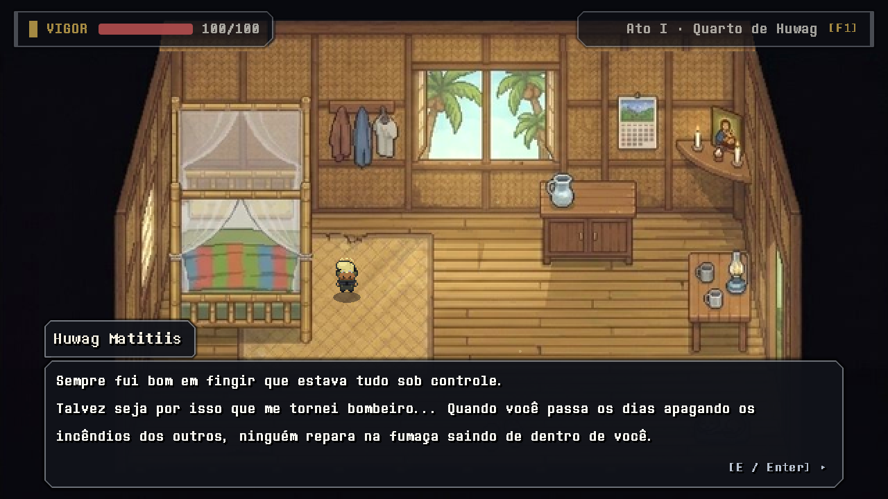
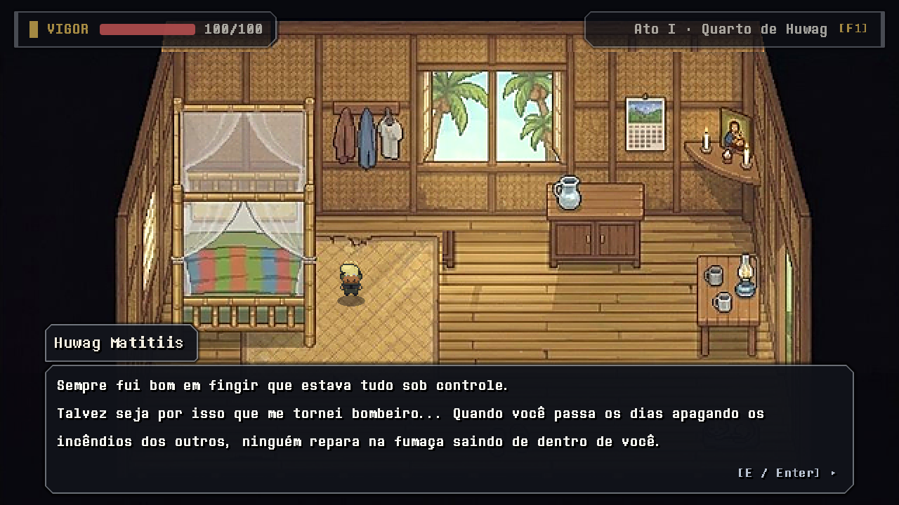
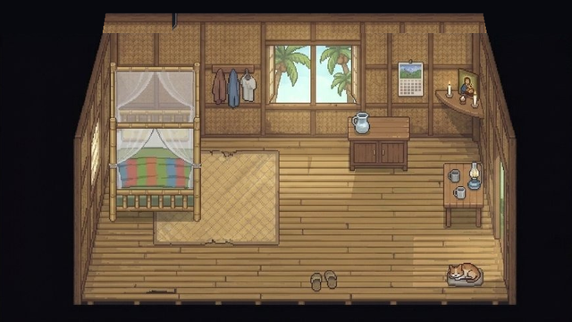
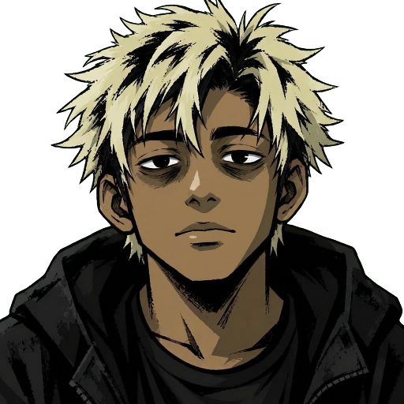
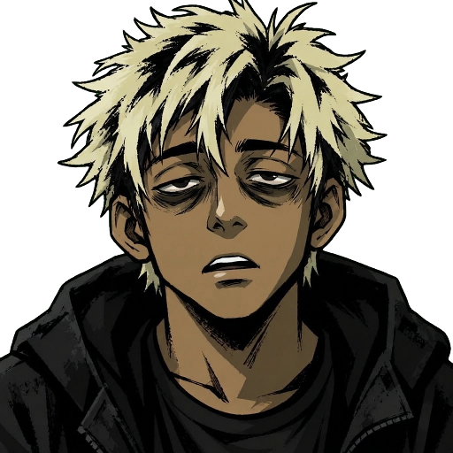
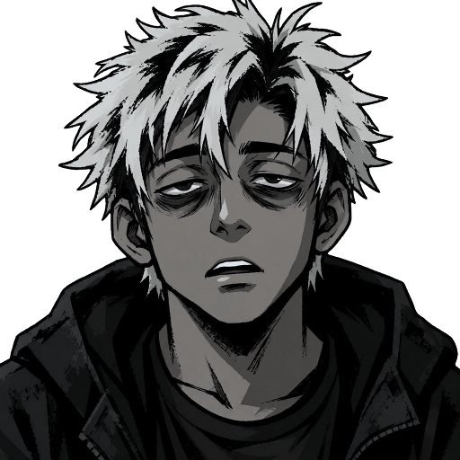
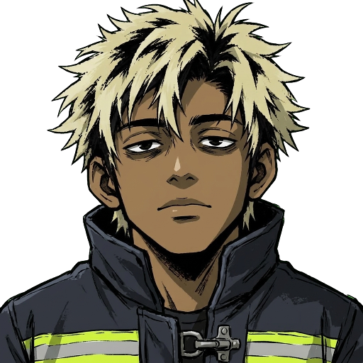
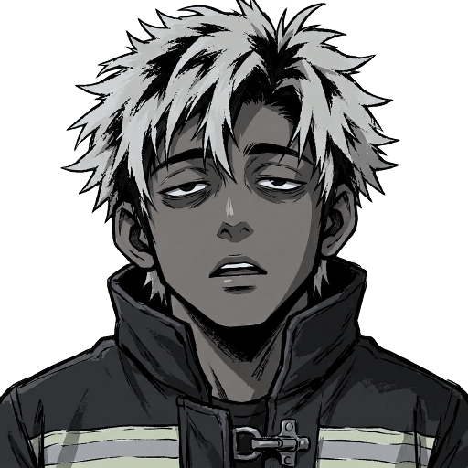
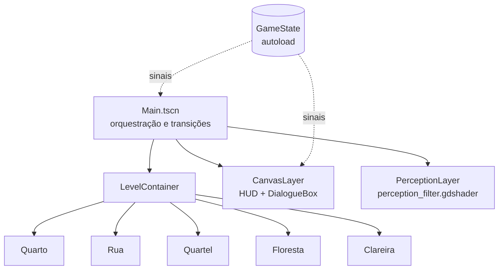
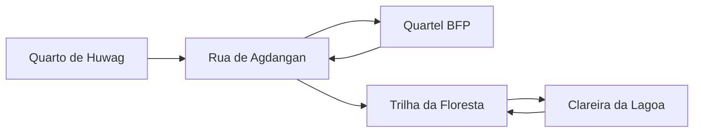

<div align="center">



# Huwag

**Uma reimplementação narrativa em Godot 4 de um RPG top-down de terror psicológico ambientado nas Filipinas.**

[](https://godotengine.org)
[](#arquitetura)
[](#recursos)
[](#roadmap)
[](#créditos-e-licenças)

[Visão geral](#visão-geral) · [Atos](#estrutura-narrativa) · [Recursos](#recursos) · [Controles](#controles) · [Arquitetura](#arquitetura) · [Como executar](#como-executar) · [Testes](#testes) · [Documentação](#documentação)

</div>

> [!IMPORTANT]
> Este é um projeto em desenvolvimento. A vertical slice cobre o quarto de Huwag, a rua de Agdangan, o quartel da BFP e a trilha/clareira da floresta. Ainda não é o jogo completo.

## Visão geral

**Huwag** acompanha **Huwag Matitiis**, 23 anos, bombeiro municipal da BFP em **Agdangan, Quezon**, nas Filipinas. A rotina de resgate e os laços de vizinhança convivem com uma percepção que muda conforme os medicamentos e a exaustão — e com uma revelação que reorganiza tudo o que veio antes.

O jogo é um RPG top-down 2D com exploração, interação, diálogos ramificados e combate leve. A violência não é a resposta padrão: encontros oferecem atacar, conversar, observar e fugir, sem um placar simples de bom ou mau.

| | |
| :--- | :--- |
| **Engine** | Godot 4.7 (GDScript, renderer `gl_compatibility`) |
| **Resolução interna** | 640 × 360, janela 1280 × 720, stretch `canvas_items` |
| **Perspectiva** | Top-down 2D com sprites 4-direcionais |
| **Conteúdo da slice** | Cinco cenários jogáveis |
| **Plataforma-alvo** | Desktop (Windows, Linux, macOS) |
| **Idioma** | Português (Brasil) |

## Estrutura narrativa

| Ato | Percepção | Estética | Foco de jogo |
| :--- | :--- | :--- | :--- |
| **I** | Manhã filtrada | Colorida e lúdica, em contraste com eventos difíceis | Rotina no quarto, rua de Agdangan, quartel BFP e primeiro contato com a criatura aquática |
| **II** | Fim de tarde | Âmbar, sombras arroxeadas e calor opressivo | Missões de resgate, trilha da floresta e a clareira da lagoa |
| **III** | Sem filtro | Monocromática, desgastada e desconfortável | Revelação e consequências, sem promessa de cura |

A continuidade narrativa é fonte de verdade e está documentada em [`docs/continuidade-narrativa.md`](docs/continuidade-narrativa.md). Diagnósticos e detalhes de medicamentos não são inventados.

## Recursos

- **Movimento top-down em 8 direções** com caminhada, corrida, agachamento e salto.
- **Combate leve** com machado de bombeiro (alcance de 44 px, arco de 120°) e magia de água.
- **Duas roupas jogáveis** — casual e farda BFP — com troca em tempo real.
- **Interação por proximidade** com prompts contextuais (`[E] Examinar`, `[E] Falar`).
- **Diálogo com retratos**, expressões faciais, escolhas e efeito de máquina de escrever.
- **Três estados de percepção** via shader: manhã filtrada, tarde âmbar e Ato 3 monocromático.
- **HUD** com vida, água, mochila e indicador de percepção.
- **Save/load em JSON** com switches, variáveis, inventário e posição.
- **Áudio procedural** de combate sintetizado em GDScript, sem dependências externas.
- **Cinco cenários** conectados: quarto, rua, quartel, floresta e clareira.
- **Testes headless** e captura automatizada de tela.

## Galeria

<div align="center">
<table>
  <tr>
    <td></td>
    <td></td>
  </tr>
  <tr>
    <td align="center"><sub>Quarto de Huwag: diálogo, retrato e HUD</sub></td>
    <td align="center"><sub>Captura da vertical slice</sub></td>
  </tr>
  <tr>
    <td colspan="2"></td>
  </tr>
  <tr>
    <td colspan="2" align="center"><sub>Cenário autoral do quarto: bambu, capiz, kulambo e vista para Agdangan</sub></td>
  </tr>
</table>
</div>

<div align="center">
<table>
  <tr>
    <td></td>
    <td></td>
    <td></td>
    <td></td>
    <td></td>
  </tr>
  <tr>
    <td align="center"><sub>Casual</sub></td>
    <td align="center"><sub>Cansado</sub></td>
    <td align="center"><sub>Sem filtro</sub></td>
    <td align="center"><sub>Farda BFP</sub></td>
    <td align="center"><sub>BFP sem filtro</sub></td>
  </tr>
</table>
</div>

## Controles

| Ação | Teclas |
| :--- | :--- |
| Mover | <kbd>W</kbd> <kbd>A</kbd> <kbd>S</kbd> <kbd>D</kbd> ou setas |
| Correr | <kbd>Shift</kbd> |
| Agachar | <kbd>Ctrl</kbd> ou <kbd>X</kbd> |
| Atacar (machado) | <kbd>J</kbd> ou <kbd>Espaço</kbd> |
| Magia de água | <kbd>K</kbd> ou <kbd>Q</kbd> |
| Pular | <kbd>V</kbd> ou <kbd>Alt</kbd> |
| Trocar roupa | <kbd>U</kbd> |
| Interagir / avançar diálogo | <kbd>E</kbd>, <kbd>Z</kbd>, <kbd>Enter</kbd> ou <kbd>Espaço</kbd> |
| Usar gota calmante | <kbd>H</kbd> ou <kbd>C</kbd> |
| Salvar | <kbd>F5</kbd> |
| Carregar | <kbd>F9</kbd> |
| Prévia de percepção | <kbd>Tab</kbd> |
| Ajuda / pausa | <kbd>F1</kbd> ou <kbd>Esc</kbd> |

Nos diálogos, use <kbd>W</kbd>/<kbd>S</kbd> ou as setas para escolher e <kbd>E</kbd>/<kbd>Enter</kbd>/<kbd>Espaço</kbd> para confirmar.

## Arquitetura





### Estrutura de pastas

```text
HuwagGodot/
├── addons/                  # Ferramentas de desenvolvimento
├── assets/
│   ├── _archive/            # Pacotes não usados (ignorados pelo Godot)
│   ├── audio/               # Reservado para SFX e música
│   ├── characters/
│   │   ├── portraits/       # Retratos casual e BFP
│   │   └── sprites/         # Spritesheets 4-direcionais
│   ├── environments/        # Cenários autorais
│   ├── fonts/               # Fonte pixelada da UI
│   ├── third_party/         # Pacotes externos em uso
│   └── ui/                  # Reservado para interface
├── docs/                    # Continuidade, arte, licenças, estrutura
│   ├── logs/                # Artefatos de execução
│   └── screenshots/         # Capturas da documentação
├── scenes/
│   ├── characters/          # Player
│   ├── components/          # Interactable
│   ├── levels/              # Cinco cenários (+ _archive/)
│   ├── main/                # Main.tscn
│   └── ui/                  # DialogueBox e HUD
├── scripts/
│   ├── audio/               # Síntese de SFX
│   ├── autoload/            # GameState
│   └── dialogue/            # Perfis de personagem
├── shaders/                 # perception_filter.gdshader
├── tests/                   # Runners headless
├── project.godot
└── README.md
```

Detalhes de convenções e fluxo de cenas em [`docs/estrutura-do-projeto.md`](docs/estrutura-do-projeto.md).

## Como executar

1. Instale o **Godot 4.7** (build padrão, sem .NET).
2. Abra o Godot, clique em **Importar** e selecione `project.godot`.
3. Pressione <kbd>F5</kbd>. A cena principal é `scenes/main/Main.tscn`.

Na primeira abertura, o Godot reimporta texturas e fontes. Se preferir a linha de comando:

```bash
godot --path .
```

Os addons em `addons/` são ferramentas de desenvolvimento e podem ser desativados em **Projeto → Configurações do Projeto → Plugins**. O autoload `_fennara_game_capture` é um auxiliar de captura e não faz parte da jogabilidade.

## Testes

Os runners usam `--headless` e gravam capturas em `docs/screenshots/`:

```bash
godot --headless --path . --script res://tests/test_full_room_suite.gd
godot --headless --path . --script res://tests/test_room_validation.gd
godot --headless --path . --script res://tests/test_room_runner.gd
godot --headless --path . --script res://tests/capture_actual_gameplay.gd
```

> Os testes exigem o executável `godot` no `PATH`. Eles ainda não foram executados neste ambiente porque a engine não está instalada; a validação atual é estática (caminhos `res://` e `source_file` dos `.import`).

## Documentação

| Documento | Conteúdo |
| :--- | :--- |
| [`docs/continuidade-narrativa.md`](docs/continuidade-narrativa.md) | Invariantes da história, personagens e revelação. |
| [`docs/direcao-de-arte.md`](docs/direcao-de-arte.md) | Paletas dos Atos 1–2 e 3, motivos e referências de Agdangan. |
| [`docs/recursos-e-licencas.md`](docs/recursos-e-licencas.md) | Proveniência, termos e política de assets. |
| [`docs/estrutura-do-projeto.md`](docs/estrutura-do-projeto.md) | Árvore de pastas, convenções e fluxo de cenas. |
| [`docs/auditoria-original.md`](docs/auditoria-original.md) | O que foi encontrado no repositório público original. |
| [`AGENTS.md`](AGENTS.md) | Regras de trabalho e integridade do projeto. |

## Créditos e licenças

**Arte autoral:** retratos, spritesheets, cenário do quarto e tipografia fazem parte deste projeto. **Pacotes externos:** `Modern_Interiors_Free_v2.2` e `Serene_Village_revamped_v1.9` (LimeZu), `Pixel Art Top Down - Basic v1.2.3` (Cainos), `Pixel Crawler - Free Pack` e `Top-Down_Retro_Interior`. Os termos completos estão em [`docs/recursos-e-licencas.md`](docs/recursos-e-licencas.md).

Este repositório **não distribui assets RTP proprietários do RPG Maker MZ**. Vários pacotes externos são de uso **não comercial**; verifique a licença antes de redistribuir ou publicar builds.

## Roadmap

- [x] Vertical slice jogável com cinco cenários
- [x] Movimento, combate leve, magia de água e troca de roupa
- [x] Diálogo com retratos, expressões e escolhas
- [x] Shader de percepção em três estados
- [x] Save/load em JSON e HUD
- [ ] Conteúdo completo dos Atos 1–3
- [ ] Retratos definitivos para Cap. Reyes, equipe do quartel e NPCs
- [ ] Música e ambiência
- [ ] Localização para inglês e filipino
- [ ] Export builds para Windows, Linux e macOS

---

<div align="center">
<sub>Feito com Godot 4 · Agdangan, Quezon, Filipinas</sub>
</div>
