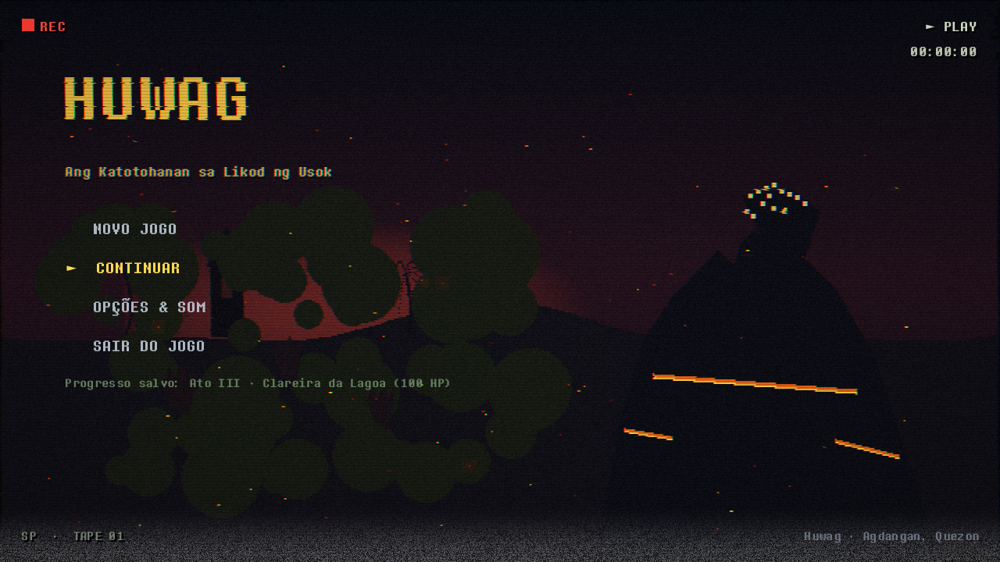
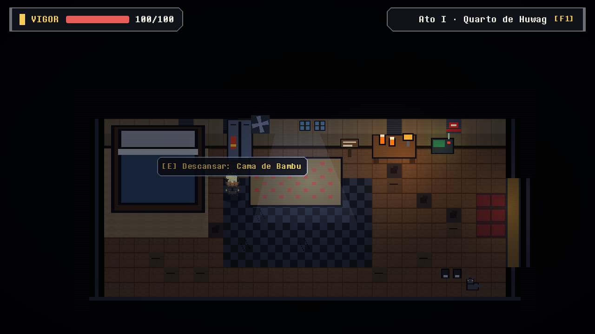
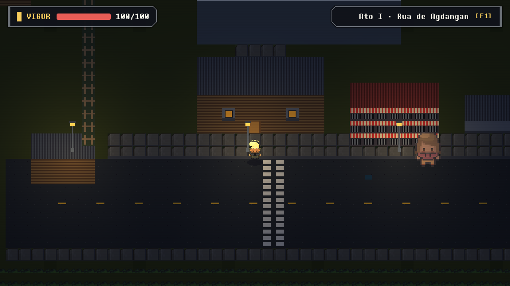
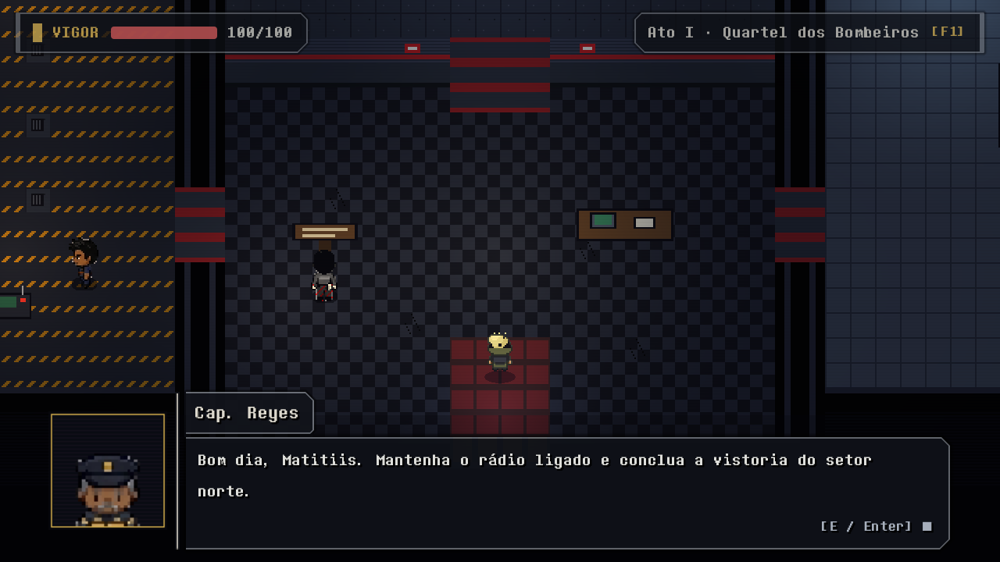
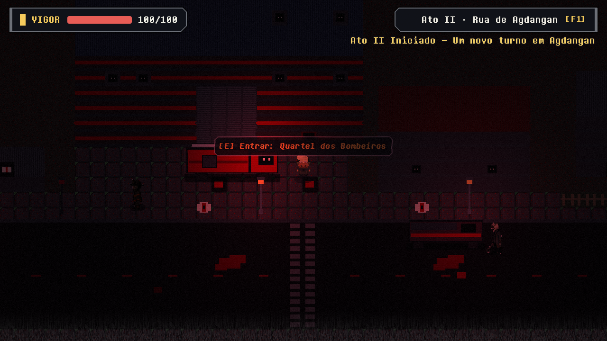
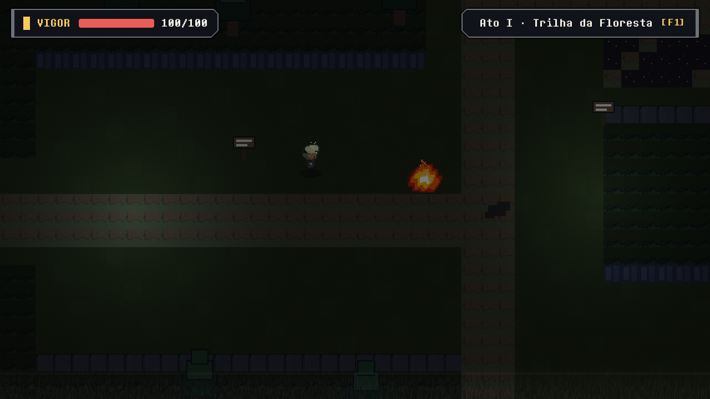
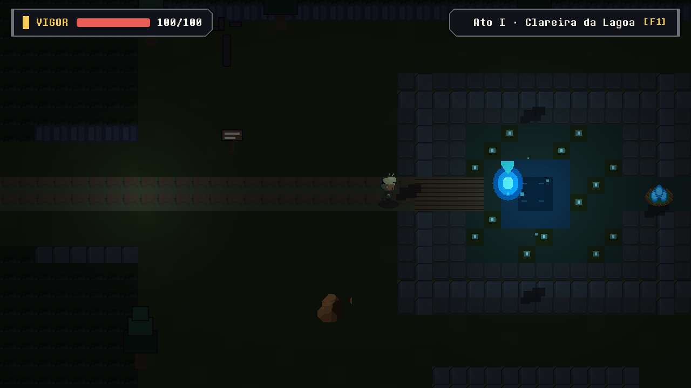
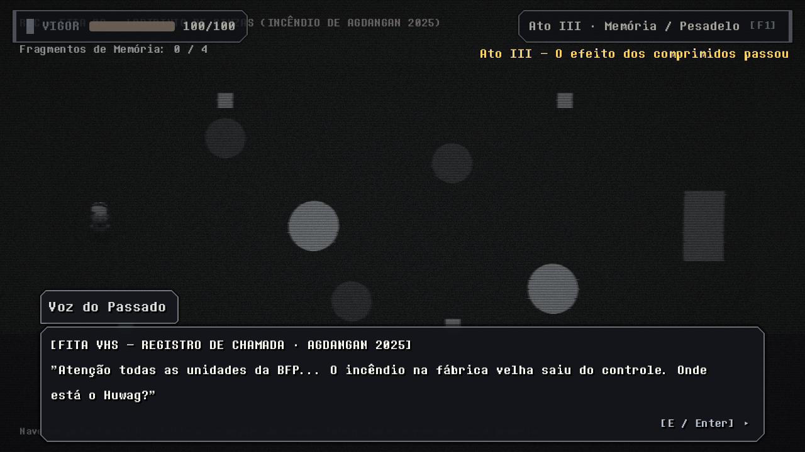
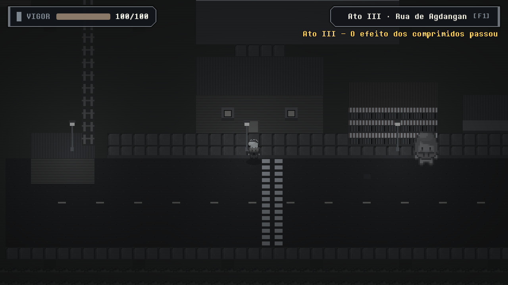
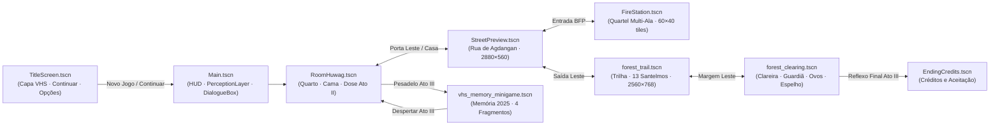

<div align="center">



<h1>HUWAG</h1>
<p><strong><em>Ang Katotohanan sa Likod ng Usok</em> — Terror Psicológico 2D em Godot 4</strong></p>


<p>
  <a href="#sobre-o-jogo">Sobre</a> •
  <a href="#galeria">Galeria</a> •
  <a href="#funcionalidades-principais">Funcionalidades</a> •
  <a href="#fluxo-dos-atos-e-cenas">Fluxo dos Atos</a> •
  <a href="#controles-e-atalhos">Controles</a> •
  <a href="#estrutura-do-projeto">Estrutura</a> •
  <a href="#como-executar-e-testar">Executar &amp; Testar</a>
</p>

</div>

---

## Sobre o Jogo

**Huwag** é um jogo narrativo de terror psicológico top-down ambientado na cidade costeira de **Agdangan (Quezon, Filipinas)**. Você controla **Huwag Matitiis**, um bombeiro do **BFP (*Bureau of Fire Protection*)** que depende de comprimidos diários para conter o trauma de um incêndio ocorrido em 2025 em uma antiga fábrica local.

Estruturado em **3 Atos**, o jogo alterna rotina comunitária, patrulha, investigação na floresta e ruptura psicológica:
- **Ato I — Manhã e Tarde Filtradas:** o cotidiano em Agdangan parece estável sob o filtro químico da medicação.
- **Ato II — Distorção e Dose Maior:** o jogador decide se aumenta ou não a dosagem dos comprimidos; a dose elevada fragmenta o mundo em estética surreal (*tilesets* alterados, olhos nas paredes, interferência VHS contínua e conflitos hostis com moradores).
- **Ato III — Realidade Sem Filtro:** o efeito cessa; a fita VHS do incêndio de 2025 revela a verdade silenciada, e Agdangan se mostra em cinza e silêncio até o confronto final diante do reflexo na lagoa.

> **Identidade Visual:** Construído em estética retrô 16×16 seguindo a hierarquia **FNAF Minigames → Yume Nikki → Chrono Trigger → Pokémon Game Boy**, com resolução base `640×360`, janela padrão `1280×720` (`canvas_items`) e amostragem `Nearest` pixel-perfect.

---

## Galeria

<div align="center">

| Quarto de Huwag (Ato I) | Avenida de Agdangan (Ato I — Dia) |
| :---: | :---: |
|  |  |
| *Interior retrô com luz volumétrica, rádio do quartel, ventilador e gatinho.* | *Bairro costeiro estendido (`2880×560`) com comércios, postes e moradores.* |

| Quartel BFP &amp; Diálogo CRT | Agdangan no Ato II — Dose Alta Distorcida |
| :---: | :---: |
|  |  |
| *Quartel multi-ala (`60×40` tiles) com retratos CRT 96×96 em diálogo.* | *Dual `TileMapLayer` + shader VHS e entidades distorcidas em dose maior.* |

| Trilha da Floresta &amp; Santelmo | Clareira da Lagoa &amp; Guardiã |
| :---: | :---: |
|  |  |
| *Labirinto `2560×768` com pontes, placas e 13 espíritos de fogo **Santelmo**.* | *Santuário `960×576` com a Guardiã da lagoa e o ninho de ovos azuis.* |

| Minigame VHS — Incêndio de 2025 | Agdangan Sem Filtro (Ato III) |
| :---: | :---: |
|  |  |
| *Sequência em fita VHS com chamas telegrafadas e 4 fragmentos de memória.* | *Dessaturação completa e atmosfera árida após o fim do efeito dos remédios.* |

<p><strong>Conclusão — Sequência Final e Créditos (Ato III)</strong></p>


</div>

---

## Funcionalidades Principais

### 1. Percepção Química, Shader VHS &amp; Dose Alta (`Ato II`)
- **`shaders/perception_filter.gdshader`**: mistura dinâmica entre manhã filtrada (`FILTERED_MORNING`), entardecer âmbar (`FILTERED_AFTERNOON`) e realidade crua dessaturada (`UNFILTERED_ACT3`), somada a scanlines CRT, aberração cromática, jitter de rastreamento, faixa de interferência e rasgo horizontal VHS em tempo real.
- **Mundo Duplo em `TileMapLayer`**: cada cenário carrega pares `Normal` e `Distorted` (`interior_fnaf_*`, `town_fnaf_*`, `forest_fnaf_*`), além de decals, luzes `PointLight2D` e variantes surreais de props.
- **Escolha de Dose (`006b_Dose_maior_pilulas`)**: no início do Ato II, optar pela dose alta alterna imediatamente o mundo para a camada distorcida, dispara pulsos periódicos de glitch VHS e revela falas alteradas e o espectro `NPC_Vulto_Bosque` na floresta.

### 2. Sistema de Diálogo CRT &amp; Escalada Hostil
- **`DialogueBox` (`scripts/ui/dialogue_box.gd`)**: texto com efeito máquina de escrever, retratos dinâmicos de Huwag (Casual e uniforme BFP) e **12 bustos CRT `96×96`** para moradores, equipe BFP e versões distorcidas (`scripts/dialogue/character_profiles.gd`).
- **Escolhas com Consequência (`conflict_choices` → `NpcEntity.turn_hostile()`)**: decisões erradas ou confrontos em diálogos do Ato II distorcido rompem a conversa e transformam o NPC em combatente hostil diretamente na cena.

### 3. Combate Top-Down &amp; Folclore Filipino
- **Movimentação &amp; Mira pelo Cursor (`scripts/characters/player.gd` + `rotate_towards_mouse.gd`)**: locomoção em 8 direções, corrida, agachamento, salto e mira direcional pelo mouse.
- **Machado BFP**: ataque em arco de `120°`, alcance `44 px` e `25` de dano base.
- **Habilidade de Água**: cone frontal (`64 px` / `110°`, `35` de dano, desbloqueada pela switch `016_Magia_de_agua_obtida`) com **dano crítico contra o Santelmo**, espírito de fogo da mitologia filipina.
- **13 Encontros na Floresta**: `SantelmoEnemy` (`scripts/enemies/santelmo.gd`) com máquina de estados (`IDLE`, `WANDER`, `CHASE`, `ATTACK`, `HURT`, `DEAD`) e dificuldade escalonada de `60` a `140` HP ao longo do labirinto.
- **Troca de Traje &amp; Cura**: alternância entre roupa casual e uniforme da BFP (`U`) e uso de **Cápsulas Calmantes** (`H` / `C`, `+35 HP`).

### 4. Áudio 100% Procedural em GDScript
- **`AudioManager` (`scripts/autoload/audio_manager.gd`)** e **`CombatSfx` (`scripts/audio/combat_sfx.gd`)** geram música, ambiências e efeitos sonoros em memória via síntese **PCM 16-bit WAV (22.050 Hz)** — incluindo tema de título, brisa matinal, cigarras vespertinas, floresta noturna, zumbido elétrico do Ato III, arpejo VHS com *wow & flutter*, chamas e SFX de combate/UI sem depender de bancos proprietários externos.

### 5. Persistência, Acessibilidade e Menu VHS
- **Save/Load JSON (`user://huwag_save.json`, v2)**: grava switches, variáveis, inventário, escolha de dose do Ato II, uniforme equipado, modo de percepção, configurações de áudio/acessibilidade e exibe resumo na opção **Continuar** do menu principal.
- **Opções &amp; Acessibilidade**: redução de flashes, alternância dos efeitos VHS no menu, sliders de volume (`Master`, `Música`, `SFX`) e alternância de tela cheia (`F11` / `Alt+Enter`).

---

## Fluxo dos Atos e Cenas



---

## Controles e Atalhos

| Categoria | Ação | Tecla / Entrada |
| :--- | :--- | :--- |
| **Exploração** | Mover (8 direções) | `W` `A` `S` `D` ou `Setas` |
| | Correr | `Shift` |
| | Agachar / Pular | `Ctrl` / `X` • `V` / `Alt` |
| | Interagir / Avançar diálogo | `E` / `Z` (e `Enter` nos diálogos) |
| | Alternar traje (Casual ↔ BFP) | `U` |
| **Combate** | Mira direcional | Cursor do Mouse (ou direção do movimento) |
| | Golpe de Machado (`25` dano) | `J` / `Espaço` / `Botão Esquerdo do Mouse` |
| | Habilidade de Água (`35` dano) | `K` / `Q` / `Botão Direito do Mouse` |
| | Usar Cápsula Calmante (`+35 HP`) | `H` / `C` |
| **Sistema &amp; Debug** | Ajuda / Lista de Controles | `F1` ou `Esc` (abre modal; `M` volta ao menu) |
| | Salvar / Carregar rápido | `F5` / `F9` |
| | Pré-visualizar Percepção (Manhã / Tarde / Ato III) | `Tab` |
| | Ciclar Atos (I → II → III) | `F10` |
| | Alternar Tela Cheia | `F11` ou `Alt + Enter` |

---

## Estrutura do Projeto

O repositório segue separação estrita entre cenas (`.tscn` em `scenes/`) e código (`.gd` em `scripts/`), mantendo apenas **2 addons opcionais leves** (`AsepriteWizard` 9.8.0 MIT e `better-terrain` Unlicense, desativados por padrão):

```text
Huwag-in-Godot/
├── addons/                       # Plugins opcionais de editor (AsepriteWizard, better-terrain)
├── assets/
│   ├── characters/
│   │   ├── portraits/            # Retratos de diálogo (Huwag Casual/BFP + bustos CRT 96×96)
│   │   ├── sprites/              # Spritesheets 4-direcionais (Huwag, NPCs e formas distorcidas)
│   │   └── aquatic_creature.png  # Guardiã da lagoa
│   ├── enemies/                  # Santelmo (santelmo.png)
│   ├── fonts/                    # Fonte pixelada global (undertale-deltarune-extended-fixed.otf)
│   ├── props/                    # Ninho de ovos azuis (blue_egg_nest.png)
│   ├── third_party/              # Pacotes externos usados nos tilesets e pedras (ver docs/recursos-e-licencas.md)
│   ├── tilesets/retro/           # Atlases 16×16 e TileSets .tres (normal e distorted)
│   └── ui/                       # Capa autoral (title_cover.png)
├── docs/                         # Continuidade narrativa, direção de arte, estrutura, licenças e screenshots
├── scenes/                       # Apenas arquivos .tscn organizados por domínio
│   ├── characters/               # Player.tscn, huwag.tscn, NpcEntity.tscn, aquatic_creature.tscn
│   ├── components/               # RotateTowardsMouse.tscn, ForestRock.tscn
│   ├── enemies/                  # santelmo.tscn
│   ├── levels/                   # RoomHuwag, StreetPreview, FireStation, forest_trail, forest_clearing, vhs_memory_minigame (+ aliases)
│   ├── main/                     # Main.tscn
│   ├── menu/                     # TitleScreen.tscn, EndingCredits.tscn
│   └── ui/                       # DialogueBox.tscn
├── scripts/                      # Todos os scripts .gd espelhando a estrutura de cenas
│   ├── audio/                    # combat_sfx.gd
│   ├── autoload/                 # audio_manager.gd, game_state.gd
│   ├── characters/               # player.gd, npc_entity.gd, aquatic_creature.gd
│   ├── components/               # interactable.gd, rotate_towards_mouse.gd
│   ├── dialogue/                 # character_profiles.gd
│   ├── enemies/                  # santelmo.gd
│   ├── levels/                   # retro_level_helpers.gd + scripts de cada nível
│   ├── main/                     # main.gd
│   ├── menu/                     # title_screen.gd, ending_credits.gd
│   ├── tools/                    # build_retro_tilesets.gd (gerador dos tilesets retrô)
│   └── ui/                       # dialogue_box.gd
├── shaders/                      # perception_filter.gdshader e vhs_glitch_tear.gdshader
├── tests/                        # Suítes automatizadas headless (test_*.gd) e capturador GPU
├── AGENTS.md                     # Regras de continuidade narrativa e desenvolvimento
└── project.godot                 # Configuração Godot 4.7 (viewport 640×360, GL Compatibility)
```

---

## Como Executar e Testar

### Requisitos
- **Godot Engine 4.7.2+** (Standard / GDScript)

### Abrir no Editor ou Jogar
1. Clone este repositório:
   ```bash
   git clone https://github.com/kerlisonz/Huwag-in-Godot.git
   cd Huwag-in-Godot
   ```
2. Abra o `project.godot` no **Godot 4.7+** e pressione **F5** para iniciar pela `TitleScreen.tscn`.

### Rodar a Suíte de Testes Automatizados (Headless)
Todos os testes do projeto podem ser executados sem interface gráfica via CLI (`tests/test_*.gd`):

```powershell
# Exemplo no Windows PowerShell (substitua pelo caminho do seu executável do Godot)
$godot = "Godot.exe"
Get-ChildItem -Path tests -Filter "test_*.gd" | ForEach-Object {
    & $godot --headless --path . --script "res://tests/$($_.Name)"
}
```

<details>
<summary><strong>Suítes incluídas em <code>tests/</code></strong></summary>

- `test_redesign_comprehensive.gd` — valida todos os cenários retrô dual-TileMapLayer, NPCs hostis, dose alta e aliases.
- `test_full_acts_flow.gd` — fluxo integral Atos I → II → III, minigame VHS e créditos finais.
- `test_full_room_suite.gd` — interações, colisões, rádio, cama, armário e saída do Quarto de Huwag.
- `test_new_street_flow.gd` — ida/volta Quarto ↔ Avenida de Agdangan e pontos de interesse.
- `test_forest_santelmo.gd` — progressão da trilha, encontro com Santelmos e combate com água/machado.
- `test_clearing_interaction_and_room.gd` — Guardiã da lagoa, ninho azul e acessibilidade da margem.
- `test_f10_advance_acts.gd` — alternância rápida de Atos (`F10`) e persistência de estado.
- `test_rotate_towards_mouse.gd` — mira direcional pelo cursor e cálculo de arco de ataque.
- `test_window_settings.gd` — configurações da `TitleScreen` (tela cheia, VHS e redução de flashes).

</details>

---

## Documentação e Licenças

Consulte o índice completo em [`docs/README.md`](docs/README.md):
- [`docs/continuidade-narrativa.md`](docs/continuidade-narrativa.md) — invariantes da história e personagens.
- [`docs/direcao-de-arte.md`](docs/direcao-de-arte.md) — paletas, hierarquia artística e referências de Agdangan.
- [`docs/estrutura-do-projeto.md`](docs/estrutura-do-projeto.md) — convenções e pipeline técnico.
- [`docs/recursos-e-licencas.md`](docs/recursos-e-licencas.md) — inventário e termos de licença de todos os pacotes externos, fontes e addons.
